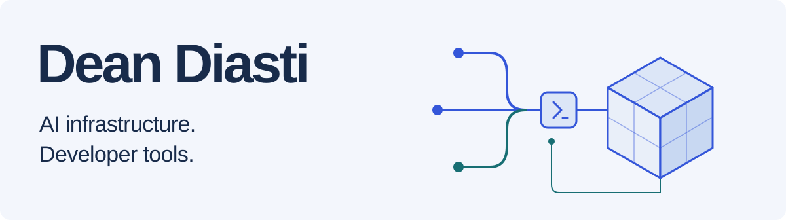

<picture>
  <source media="(max-width: 600px) and (prefers-color-scheme: dark)" srcset="assets/profile-dark-mobile.svg">
  <source media="(max-width: 600px) and (prefers-color-scheme: light)" srcset="assets/profile-light-mobile.svg">
  <source media="(prefers-color-scheme: dark)" srcset="assets/profile-dark.svg">
  <source media="(prefers-color-scheme: light)" srcset="assets/profile-light.svg">
  
</picture>

I'm a software engineer building AI infrastructure and developer tools. I work on
agent runtimes, identity and access control, and the interfaces that connect
software to the physical world.

[LinkedIn](https://www.linkedin.com/in/deandiasti/) &nbsp; / &nbsp;
[Email](mailto:ddiasti908@gmail.com)

## Selected work

### [Clodex](https://github.com/DeanDiasti/clodex)

A local launcher that connects Claude Code's interface to Codex models, with
optional Claude model routing alongside them.

Built in **Rust** with a loopback bridge, streaming protocol translation,
authentication, and a shared backend supervisor for concurrent sessions.

[Explore the code](https://github.com/DeanDiasti/clodex/tree/main/src) &nbsp; / &nbsp;
[Releases](https://github.com/DeanDiasti/clodex/releases)

### [fusion-cli](https://github.com/DeanDiasti/fusion-cli)

A typed command-line interface for Autodesk Fusion: model parametric parts,
work with assemblies, preview joint motion, and inspect interference.

Built in **Python** with a shared command catalog, authenticated localhost bridge,
main-thread CAD dispatch, and verified session checkpoints. Host tests and
published native validation evidence document what the integration supports.
Distributed through my [Homebrew tap](https://github.com/DeanDiasti/homebrew-tap).

[Installation and demos](https://deandiasti.github.io/fusion-cli/) &nbsp; / &nbsp;
[Validation approach](https://github.com/DeanDiasti/fusion-cli/blob/main/docs/validation.md)

## Beyond the public repos

- **AI governance at Alterion.** Identity resolution with eBPF, OAuth and Keycloak
  integration, and agent tooling with OpenTelemetry instrumentation.
- **Backend systems at Seqoria.** Authentication and AI agent microservices,
  external tool integration, and deployments on AWS ECS and Fargate.
- **Applied machine learning.** Vision and video pipelines at Frags AI;
  project work in vision transformers, multimodal learning, drone detection,
  and CUDA programming.

## My toolkit

| Area | Tools and techniques |
| :--- | :--- |
| Languages | Python, Rust, C++, JavaScript, SQL |
| AI systems | Agent runtimes, MCP, real-time speech pipelines, OpenTelemetry |
| Backend & identity | FastAPI, OAuth 2.0, JWT, Keycloak, Redis |
| Infrastructure | AWS, Docker, GitHub Actions, Linux |
| Machine learning | PyTorch, TensorFlow, scikit-learn, CUDA, computer vision |
